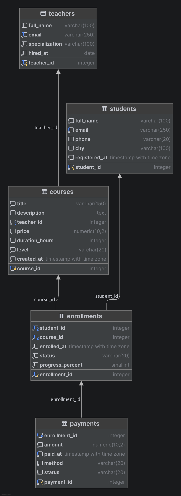

# Online School DB

Учебный проект: реляционная база данных онлайн-школы на PostgreSQL. В ней хранятся студенты, преподаватели, курсы, записи на курсы и платежи. Поверх схемы написаны аналитические запросы, которые отвечают на бизнес-вопросы школы: какие курсы приносят больше денег, где студенты бросают обучение, у кого есть незавершённая оплата.

## Что умеет база

- Хранит студентов и преподавателей, каталог курсов, записи студентов на курсы (со статусом и прогрессом) и платежи.
- Поддерживает оплату в рассрочку: на одну запись может приходиться несколько платежей.
- Защищает данные ограничениями целостности: уникальные email, проверки цен и прогресса, допустимые значения статусов, внешние ключи.

## Технологии

- PostgreSQL
- DataGrip
- Git и GitHub

## Схема данных



| Таблица | Назначение | Ключевые поля |
|---|---|---|
| `teachers` | Преподаватели | `teacher_id` (PK), `email` (UNIQUE), `specialization`, `hired_at` |
| `students` | Студенты | `student_id` (PK), `email` (UNIQUE), `city`, `registered_at` |
| `courses` | Курсы | `course_id` (PK), `teacher_id` (FK), `price`, `level`, `duration_hours` |
| `enrollments` | Записи студентов на курсы (таблица-связка m:n) | `enrollment_id` (PK), `student_id` (FK), `course_id` (FK), `status`, `progress_percent` |
| `payments` | Платежи по записям | `payment_id` (PK), `enrollment_id` (FK), `amount`, `paid_at`, `method`, `status` |

### Связи

- Один преподаватель ведёт много курсов (1:n): `courses.teacher_id → teachers`.
- Студенты и курсы связаны «многие ко многим» через таблицу-связку `enrollments`.
- Одна запись на курс может иметь несколько платежей (1:n): `payments.enrollment_id → enrollments`.

### Нормализация

База приведена к третьей нормальной форме (3НФ): нет повторяющихся групп, каждый атрибут зависит только от ключа своей таблицы. Данные преподавателя не дублируются в курсах, данные студента не дублируются в записях. Атрибуты, которые относятся к паре «студент и курс» (статус, прогресс, дата записи), вынесены в `enrollments`.

### Ограничения целостности

- Первичные ключи заданы явно (`GENERATED ALWAYS AS IDENTITY`).
- `UNIQUE`: email студентов и преподавателей; пара `(student_id, course_id)` в `enrollments`, чтобы нельзя было записаться на курс дважды.
- `CHECK`: цена и сумма платежа положительны, прогресс от 0 до 100, статусы и уровни из допустимых списков.
- Правила удаления: `ON DELETE CASCADE` для записей студента, `ON DELETE RESTRICT` для курсов, преподавателей и платежей, чтобы не потерять справочные и финансовые данные.

## Структура репозитория

```
online_school_db/
├── README.md
├── .gitignore
├── data/                          # тестовые данные в CSV
├── docs/
│   ├── explain_before.txt         # план запроса до индексов
│   └── explain_after.txt          # план запроса после индексов
└── sql/
    ├── 01_schema.sql              # создание таблиц
    ├── queries_for_analyst.sql    # аналитические запросы
    └── views_indexes.sql          # индексы
```

## Как запустить

1. Установите PostgreSQL и создайте базу данных:
   ```sql
   CREATE DATABASE online_school;
   ```
2. Подключитесь к ней и выполните `sql/01_schema.sql`. Скрипт можно запускать повторно: сначала он удаляет старые таблицы (`DROP TABLE IF EXISTS`), затем создаёт новые.
3. Загрузите данные из папки `data/` **строго в таком порядке**: `teachers`, `students`, `courses`, `enrollments`, `payments`. Первичные ключи выдаются автоматически, поэтому каждую таблицу нужно загружать один раз и по порядку, иначе ссылки между таблицами перестанут совпадать. В DataGrip: правый клик по таблице, Import/Export, Import Data from File (в настройках включите, что первая строка файла является заголовком). В `psql` можно использовать `\copy`.
4. Проверьте количество строк: `teachers` 10, `courses` 15, `students` 300, `enrollments` 549, `payments` 735.
5. При желании выполните `sql/views_indexes.sql` (индексы) и `sql/queries_for_analyst.sql` (аналитика).

## Тестовые данные

Данные синтетические и не содержат реальных людей: 10 преподавателей, 15 курсов, 300 студентов, 549 записей на курсы и 735 платежей. В наборе есть разные сценарии: полная оплата, рассрочка в 2-3 платежа, возвраты, неуспешные и ожидающие платежи, отменённые записи.

## Аналитические запросы

Файл `sql/queries_for_analyst.sql` отвечает на вопросы:

- Какие начальные курсы стоят дешевле 10 000?
- Сколько записей на курсы завершено?
- Сколько курсов ведёт каждый преподаватель?
- Какие курсы принесли больше 50 000 выручки (по успешным платежам)?
- Какие студенты отменяли записи, но не завершили ни одного курса?
- Каков средний прогресс по курсам, где не меньше 5 активных записей?
- Топ-3 курса среднего уровня по выручке за 2026 год.
- Какие студенты завершили больше курсов, чем в среднем среди завершивших хотя бы один?
- Как курсы соотносятся друг с другом по выручке внутри своего уровня сложности (оконные функции: место в рейтинге и доля выручки уровня)?

В запросах используются `WHERE`, `ORDER BY`, агрегатные функции, `JOIN`, подзапросы, CTE и оконные функции (`RANK`, `SUM() OVER`).


## Индексы

В файле `sql/views_indexes.sql` созданы индексы на столбцы соединений и фильтрации:

- `idx_enrollments_course_id` на `enrollments (course_id)`
- `idx_payments_enrollment_id` на `payments (enrollment_id)`
- `idx_payments_paid_at` на `payments (paid_at)`

### Замеры `EXPLAIN ANALYZE`

Для замера использован запрос выручки по курсам (суммы успешных платежей по каждому курсу, `HAVING SUM(amount) > 50000`). Планы сохранены в `docs/explain_before.txt` и `docs/explain_after.txt`.

| | До индексов | После индексов |
|---|---|---|
| Чтение таблиц | `Seq Scan` по `payments`, `enrollments`, `courses` | `Seq Scan` по тем же таблицам |
| `Execution Time` | 0.479 мс | 0.563 мс |

**Вывод.** План не изменился: PostgreSQL продолжил читать таблицы целиком и индексы не использовал. Разница во времени находится в пределах погрешности замера. Причины:

1. Таблицы небольшие (сотни строк), и полный просмотр быстрее, чем обращение к индексу.
2. Запрос агрегирует почти все строки таблиц (653 из 735 платежей проходят фильтр), а индексы выгодны, когда нужна небольшая часть строк.

Индексы начинают приносить пользу на больших объёмах данных и в запросах с узкой выборкой (например, платежи за короткий период или по одному курсу).

# Представления (VIEW)
### Представление `v_course_revenue`

Представление используется для анализа дохода от курсов. Оно объединяет таблицы `courses`, `enrollments` и `payments`, рассчитывает общую сумму успешных платежей по каждому курсу и оставляет только курсы, доход от которых превышает 50 000.

**Логика работы:**
- `JOIN` — объединяет информацию о курсах, записях студентов и платежах.
- `WHERE payments.status = 'success'` — учитывает только успешно завершённые платежи.
- `SUM(amount)` — рассчитывает общую выручку по каждому курсу.
- `GROUP BY course_id, title` — группирует платежи по курсам.
- `HAVING SUM(amount) > 50000` — оставляет курсы с выручкой более 50 000.
- `ORDER BY sum_course DESC` — сортирует курсы по убыванию выручки.

**Пример использования:**

```sql
SELECT *
FROM v_course_revenue;
```

**Результат:** список курсов, выручка от которых превышает 50 000, с указанием названия курса и общей суммы успешных платежей.

# Резервное копирование

Резервная копия базы сделана утилитой `pg_dump` в сжатом формате custom и лежит в `backup/online_school.dump`. Она содержит таблицы, данные, индексы, ограничения и внешние ключи.

### Создание копии

```
pg_dump -h localhost -U postgres -d online_school -F c -f backup/online_school.dump
```

Параметры: `-h localhost` и `-U postgres` задают сервер и пользователя, `-d online_school` базу, `-F c` формат custom, `-f` путь к файлу.

Дополнительно можно сделать копию в виде обычного SQL-файла (её можно открыть и прочитать):

```
pg_dump -h localhost -U postgres -d online_school -F p -f backup/online_school.sql
```

### Восстановление

Восстанавливать нужно в **пустую** базу, иначе `pg_restore` выдаст ошибки «already exists» для всех объектов.

1. Создайте пустую базу:
```sql
   CREATE DATABASE online_school_restore;
```
2. Восстановите в неё копию:
```
   pg_restore -h localhost -U postgres -d online_school_restore backup/online_school.dump
```
Для копии в формате SQL используется `psql`:
```
   psql -h localhost -U postgres -d online_school_restore -f backup/online_school.sql
```
3. Чтобы восстановить поверх существующей базы, добавьте параметры `--clean --if-exists`: сначала удаляются старые объекты, затем создаются заново.

### Проверка

Восстановление проверено на отдельной базе `online_school_restore`: количество строк в таблицах совпало с оригиналом (`teachers` 10, `courses` 15, `students` 300, `enrollments` 549, `payments` 735).

## Автор

Mark Volozhaninov
https://github.com/vvmksh
